<p align="center">
  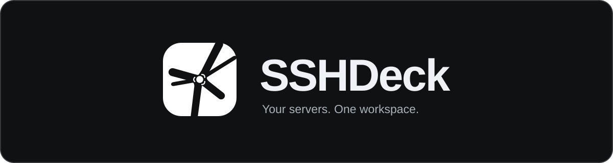
</p>

<p align="center"><strong>The SSH workspace built for touch.</strong><br>
Start on your PC, carry on from your phone, finish back at your desk — in the same live session, from any browser.</p>

<p align="center">
  <a href="#quick-start">Get started</a> ·
  <a href="#built-for-touch">Touch</a> ·
  <a href="#one-session-every-device">Every device</a> ·
  <a href="#on-the-desktop">Desktop</a> ·
  <a href="#documentation">Documentation</a>
</p>

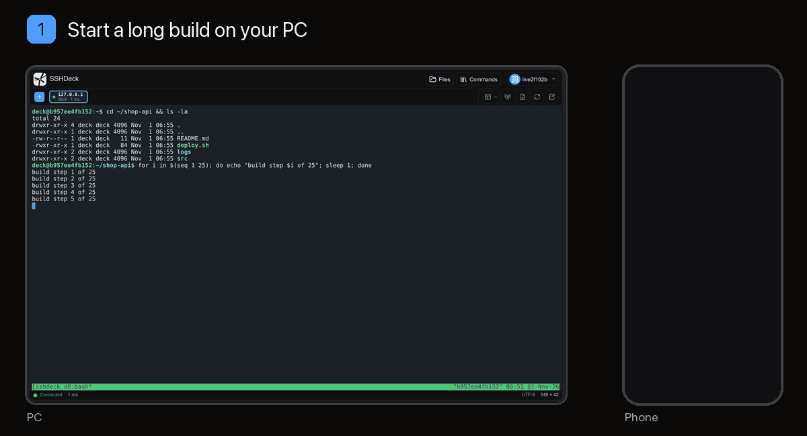

Many web terminals that "work on mobile" are a desktop page squeezed onto a small screen: the keyboard covers the prompt, a tap opens the keyboard when you only wanted to scroll, special keys are missing, and the layout jumps every time something changes size. SSHDeck was designed the other way round. Every touch, swipe, keyboard and screen-size behaviour was built and tested for coding from a phone, and the interface stays minimal on a small screen without dropping the things you do on a PC.

SSHDeck is self-hosted: run it on your own server, sign in from a browser, and your sessions live on your machines.

## Why SSHDeck

- **Built for touch, not adapted to it.** A composer that mirrors the line you are typing, the keys a phone keyboard lacks, a keyboard that pushes the terminal up instead of resizing it, history you scroll with a swipe, links you open with a tap. [More below](#built-for-touch).
- **One session, every device, at the same time.** Open the same session on your PC, tablet and phone at once. What you type on one appears on the others as it happens.
- **Sessions that don't drop.** Close the browser, lose the network, restart SSHDeck itself: the session keeps running on your server and comes back where you left it, in the same pane.
- **Nothing to install on the server either.** If a server has no tmux, SSHDeck provides it — from the system package manager when it can, or as a self-contained copy in your home directory when it cannot, which needs no root.
- **Any browser, anywhere.** Your own laptop, a borrowed PC, a tablet: open the address and sign in. Install it on your home screen if you want it to feel like an app.
- **Simple on the outside, complete on the inside.** Split panes, a file browser, server-to-server transfers, reusable commands, broadcast to many servers, notes, ten themes and six languages.

## Quick start

```bash
docker run -d --name sshdeck \
  -p 127.0.0.1:5000:5000 \
  -e CORS_ORIGINS=http://localhost:5000 \
  -e SESSION_COOKIE_SECURE=false \
  -e TMUX_ENABLED=true -e TMUX_DEFAULT=true \
  -v sshdeck_data:/app/data \
  --restart unless-stopped \
  ghcr.io/nguyenha935/sshdeck:latest
```

Open [localhost:5000](http://localhost:5000), create the first account — it becomes the administrator — and choose **New Connection**.

SSHDeck generates its `SECRET_KEY` on first start and keeps it in the data volume with your accounts; keep that volume across updates. To use SSHDeck from your phone or another computer, put it behind HTTPS with an explicit public origin: see the [deployment guide](docs/getting-started.md). [Docker Compose](docker-compose.yml) and [running from source](docs/getting-started.md#run-from-source) are supported too.

## Built for touch

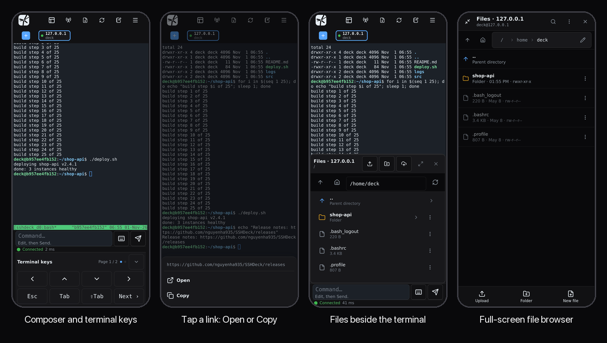

### Typing

- **The composer mirrors your input line.** Type at the bottom of the screen and the same text appears on the remote prompt as you type; nothing runs until you press **Send**. Paste a long command, fix it, then send it.
- **Input methods work.** Vietnamese and other input methods send exactly the text they commit — once, in order, even when the browser is busy.
- **The keys a phone keyboard doesn't have**: Esc, Tab, Shift-Tab, arrows, Home, End, Page Up/Down, Delete, and one-shot Ctrl and Alt for the next key.
- **The keyboard opens when you mean it.** Tap the terminal's own input line — the row with the cursor — and the keyboard comes up. Tap anywhere else to read or scroll without it popping open.
- **The keyboard pushes the terminal up; it doesn't resize it.** Opening the keyboard or the keys panel moves the content so the cursor stays visible. The remote window keeps its size, so full-screen programs don't redraw and your other devices are not squeezed.

### Moving around

- **Swipe to scroll history**, including tmux history, and get back to the live prompt with one tap.
- **Tap a link** in the output to get Open and Copy, placed above the keyboard.
- **Switch sessions** from the chips at the top; press and hold a chip to drag it into a new order.
- **Two panes side by side in landscape.** Portrait shows the active pane full size; rotate the phone and both appear.
- **Rotation, notches and on-screen keyboards** keep the header and the session strip where they belong.

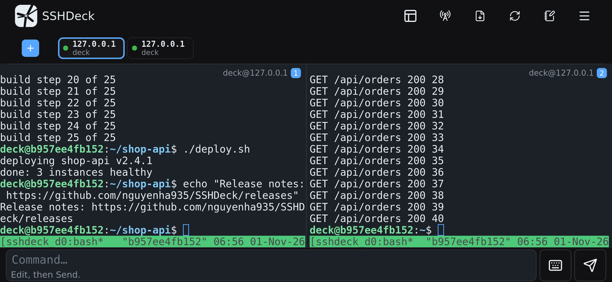

### Files on a phone

The **Files** sheet browses the active connection while the terminal stays visible above it. Expand it into a full-screen browser to upload, download, rename, create and delete — with a menu on every row instead of a right-click.

### Install it like an app

Add SSHDeck to your home screen (Safari: **Share → Add to Home Screen**; Chrome: **Install app**). It opens in its own full-screen window with its own icon. There is no app-store app to install and nothing to update on the phone: every device always runs the version on your server.

## One session, every device

- **Live on several devices at once.** Every browser gets its own view of the remote tmux session, so a phone, a tablet and a PC can all follow and type into it together. The terminal size follows the smallest device that is looking; a browser tab in the background lets go of its view.
- **Survives everything short of the server going away.** Closing the browser, an idle SSH timeout, a network change or an SSHDeck restart leaves the remote session running. Your browser reconnects by itself and puts each session back in its pane. Sessions using a key or Tailscale reconnect without asking; password sessions ask for the password again.
- **tmux appears where it's missing.** A server without tmux gets one when you connect: through apt, dnf, yum, apk, pacman or zypper if you are root or have passwordless sudo, otherwise, on Linux x86_64 and aarch64, as a static copy in `~/.local/share/sshdeck/bin` running on its own socket. tmux sessions already on the server are left alone.
- **Using someone else's computer?** There is nothing to install — open the address and sign in. Sign out when you leave. SSHDeck does not yet offer two-factor sign-in, so prefer your own devices for accounts that reach important servers.

Persistence uses tmux on the remote host and can be switched off per connection; without it a session is an ordinary shell that lasts as long as the connection. See [session behaviour](docs/workflows.md#persistent-sessions).

## On the desktop

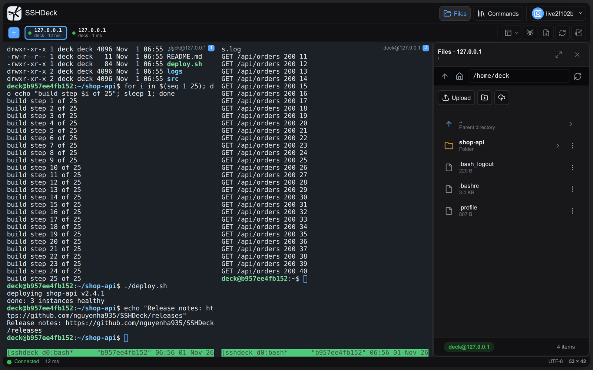

- **Split panes**: up to 6 on a desktop, 4 on a tablet and 2 on a phone in landscape.
- **Files**: a panel beside the terminal, or a full browser with columns, sorting, filtering, multi-select, keyboard shortcuts and inline rename.
- **File Transfer** between any two places — any of your servers, server to server, or a folder on your computer where the browser allows it — with progress and cancellation.
- **Broadcast** a command to every connected session, or to a chosen few, after reviewing the targets.
- **Command Library and Command Sets** keep the commands you run every day one click away, and can run them right after a connection opens.
- **Notes** per account or per server, next to the terminal.

<details>
<summary>Screenshots: File Transfer, command library, command sets</summary>

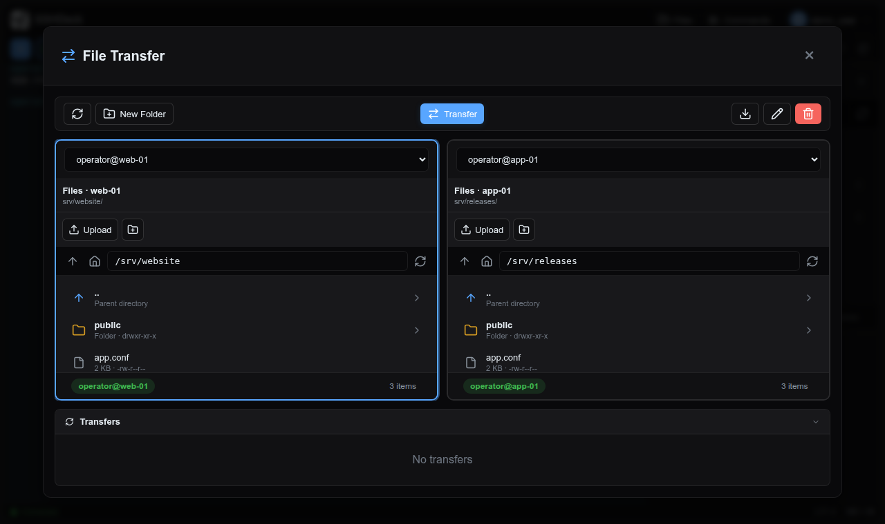

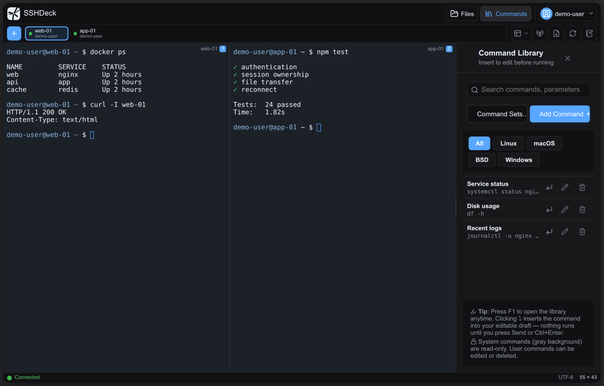

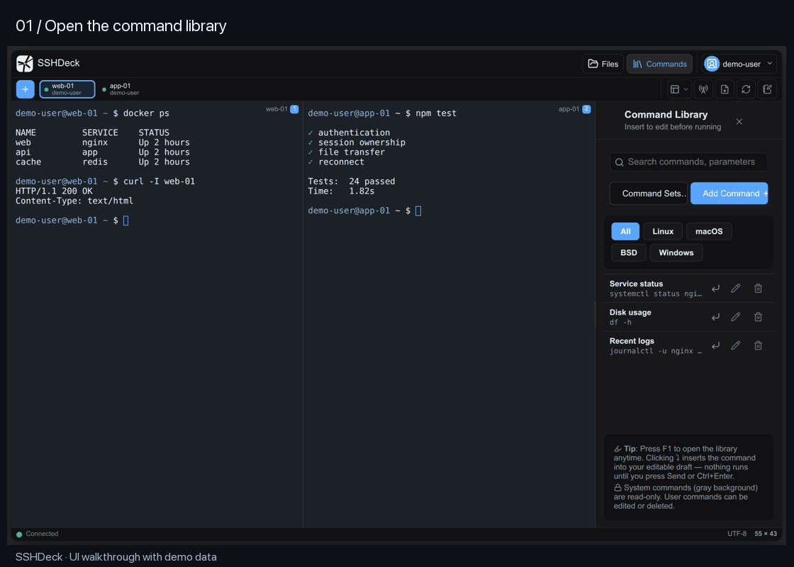

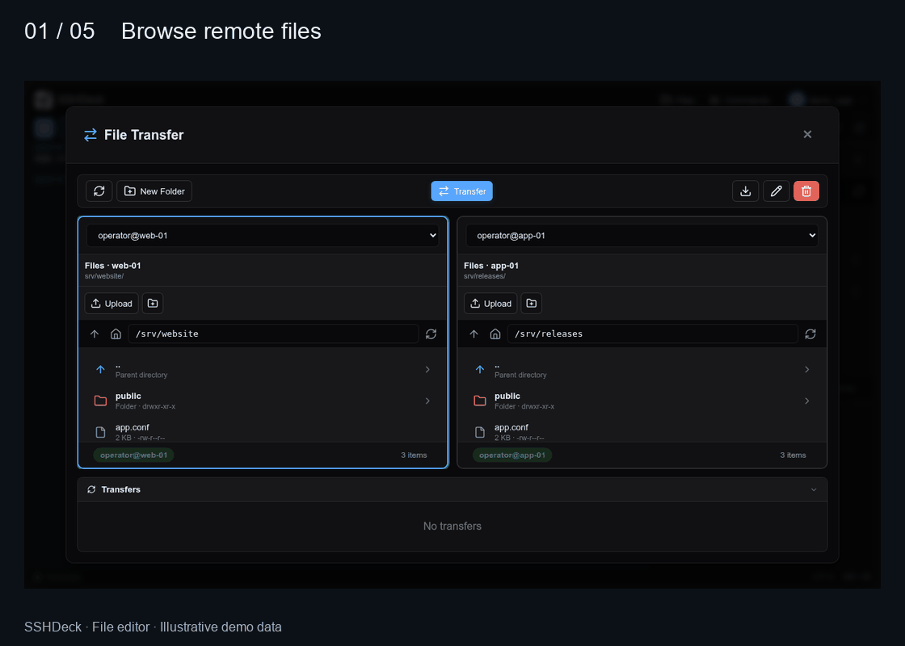

</details>

<details>
<summary>Command Sets: execution, sudo, references and legacy profiles</summary>

The connection dialog offers four explicit choices under **Run after
connecting**: nothing, one reusable **Command Set**, one saved **Command**, or
one-off **Free text**. Only the active mode is sent to the server. An exact
preview shows what will run before the connection is started. A selected
Command can use its saved parameters, an override, or an intentionally empty
override without modifying the library entry.

Open **Commands** for the command-library rail, then **Command Sets…** for the separate set-management dialog. The library supports search and operating-system filters; the set builder lets you select library commands and add free-text steps.

A command set is an ordered list of steps. A step can reference a command from
the command library or contain free text. Library steps use the command's
current parameters by default; disable **Use library parameters** to provide an
override or intentionally leave the override empty. Free-text steps can stay in
the set or be moved into the command library with **Save as library command**.
Steps can be reordered by drag and drop or by the accessible up/down buttons.

**Run commands with sudo** is opt-in for new command sets. When enabled, SSHDeck
prefixes each non-empty resolved command line unless it already starts with
`sudo`; blank and comment-only lines remain unchanged. Existing command sets
from an earlier version and sets produced by legacy conversion keep their saved
sudo setting, so upgrading or converting does not change what runs.

SSHDeck does not store or answer a sudo password. If the remote account requires
one, its normal prompt appears in the terminal. The added prefixes count toward
the existing maximum 4096 characters for the resolved command text.

Profiles are managed independently from connecting under the account menu.
They can be created, inspected, updated, or deleted without opening an SSH
session. A profile stores the selected post-connect mode and only its relevant
reference or free text; credentials are never stored. Editing a referenced set
or library command therefore updates every profile that uses its saved
definition. A set cannot be deleted while a profile references it, and a
user-created library command cannot be deleted while a set or profile
references it. The UI reports the profiles or sets that must be changed first.

After a new SSH connection succeeds, SSHDeck resolves the latest referenced
commands on the server, validates the combined text (maximum 4096 characters),
and sends the steps to the remote interactive shell in their saved order.
Resolved command-set steps are joined with `&&` only between steps, so the next
block starts only when the preceding block succeeds. SSHDeck does not rewrite a
step: line breaks inside a free-text step remain unchanged, including its
authored shell control flow, and the final command's exit status determines
whether the next step starts. The commands run on the remote SSH host, never
inside the SSHDeck container. Reattaching to an existing persistent tmux session does not run them again.

Existing profiles that still contain the former free-text startup commands keep
working after an update. They show a legacy notice in the connection dialog and
can be converted into a named set. Conversion creates the set first, then links
the profile; the old text remains stored as a fallback but is ignored while the
new set reference is valid. The profile's legacy startup commands retain their
original multiline behavior until they are converted.

Command output and errors appear normally in the terminal. The remote shell
evaluates the `&&` chain; SSHDeck does not interpret exit statuses itself. Treat
command sets like any other remote administration automation: review their
contents and grant SSHDeck accounts only the SSH privileges they actually need.

No additional environment variable, Compose setting, frontend build step, or
external service is required. Command sets are stored per user in the existing
`DATA_DIR` volume alongside profiles and the command library.

</details>

## Connect

- **Password, SSH key or [Tailscale SSH](docs/tailscale-ssh.md)**, directly or through a **jump host**.
- **Keys**: import RSA, Ed25519 or ECDSA private keys; they are stored encrypted at rest. Passphrase-protected imported keys and DSA keys are not supported.
- **Profiles** save host, user, authentication choice, jump host and what to run after connecting. Profiles never store SSH passwords.
- Tailscale SSH uses the SSHDeck node's shared identity and is limited to administrators and explicitly allowed users.

<details>
<summary>Screenshots: connection dialog and keys</summary>

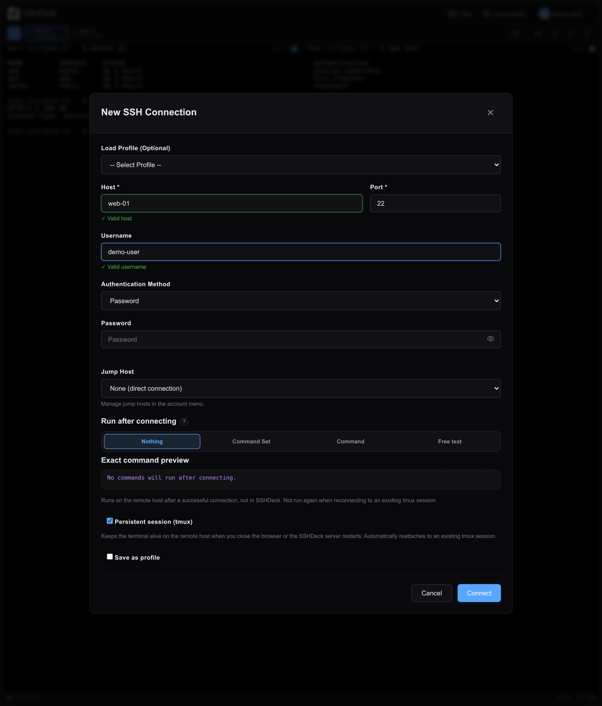

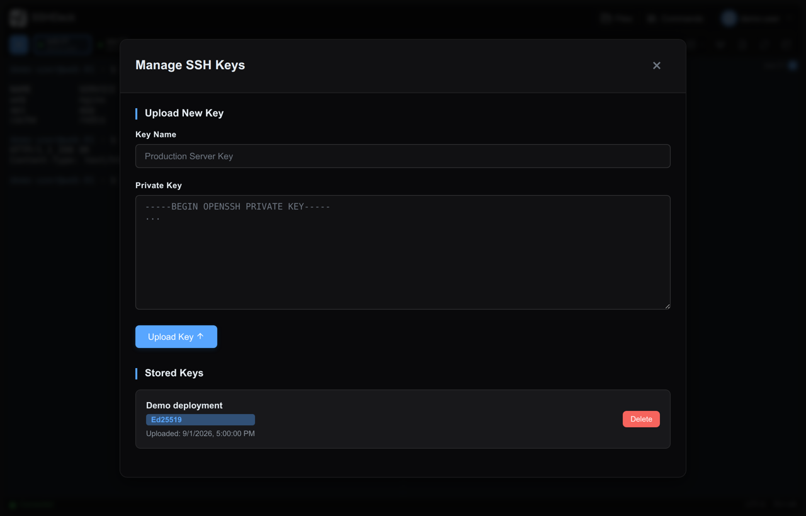

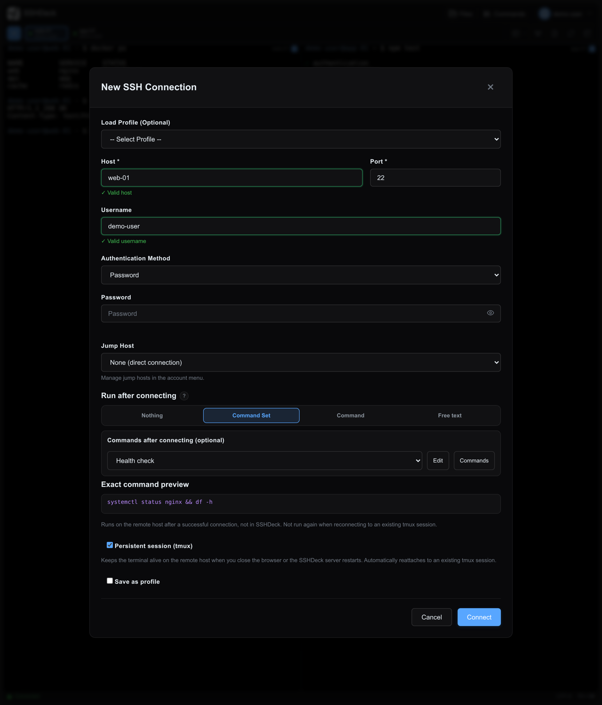

</details>

## Make it yours

Choose from **10 themes** and **6 interface languages**: English, Vietnamese, German, Spanish, French and Chinese. Paper Ops is the light theme.

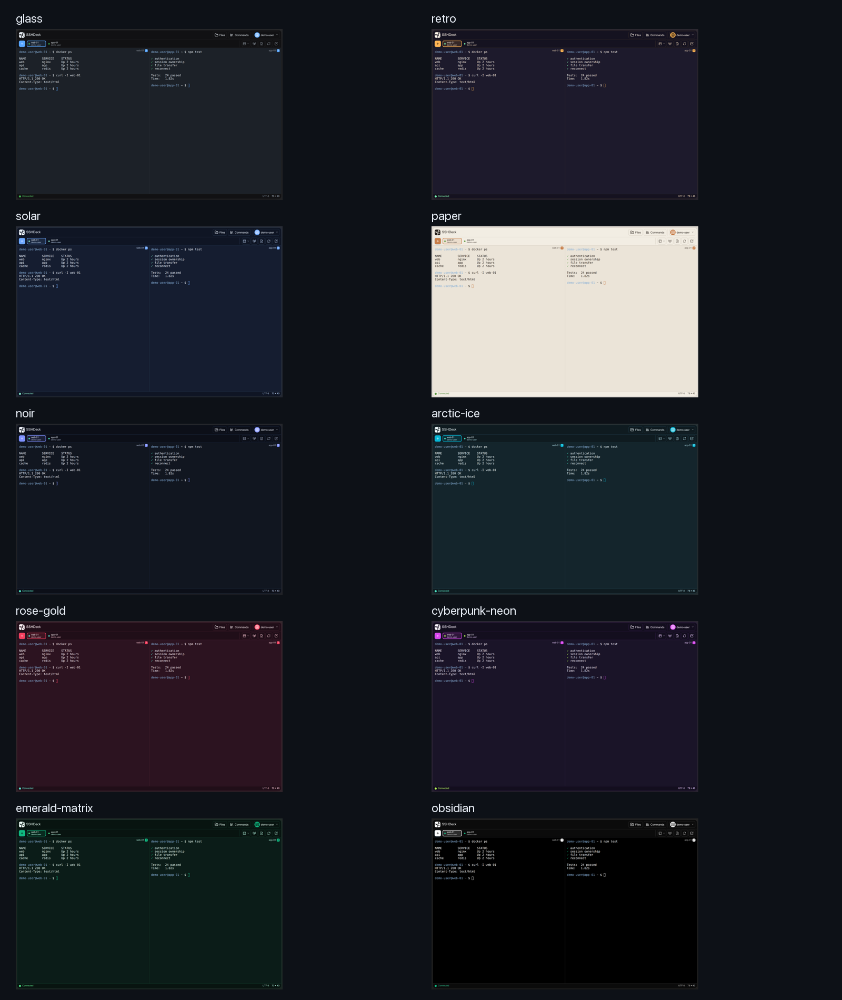

Several people can share one SSHDeck, each with their own profiles, keys, commands, notes and settings. Administrators manage accounts, lock access, review audit events, close running sessions, turn registration off and change runtime limits, all from **Settings**.

## Hosting and trust

SSHDeck is the SSH client. Your browser connects to SSHDeck, and SSHDeck connects to your servers. Terminal content and file transfers pass through this host; trust and protect it accordingly.

- Use HTTPS, an explicit allowed origin and correctly configured proxy trust for remote access.
- Keep the application **single-worker**: live SSH connections are held in process memory. Optional Redis rate limiting does not change this requirement.
- Back up the data directory and keep `SECRET_KEY` stable. Access to both the secret and encrypted key files allows decryption.
- New SSH host keys are accepted on first use and persisted; changed known keys are rejected.
- SSHDeck uses local accounts. It does not currently provide MFA or LDAP/SSO.

Read [hosting and data protection](docs/hosting.md) for credential handling, retained data, account deletion and SSH compatibility. Report vulnerabilities privately as described in [SECURITY.md](SECURITY.md).

<a id="subfolder-deployment"></a>

For deployment under `/sshdeck`, see [Subfolder Deployment](docs/configuration.md#subfolder-deployment).

## Documentation

| Guide | Contents |
| --- | --- |
| [Getting started](docs/getting-started.md) | Docker, Compose, source installation and first connection |
| [Workflows](docs/workflows.md) | Sessions, terminal interaction and both file surfaces |
| [Configuration](docs/configuration.md) | Environment variables, runtime overrides and reverse proxies |
| [Hosting and data protection](docs/hosting.md) | Trust boundaries, backups and SSH compatibility |
| [Tailscale SSH](docs/tailscale-ssh.md) | Shared identity, authorization and deployment |
| [Contributing](CONTRIBUTING.md) | Development setup, tests and the contribution workflow |
| [Commercial licensing](COMMERCIAL.md) | When a commercial licence is needed, and how to get one |
| [Changelog](CHANGELOG.md) | Release history |

The images at the top of this page are captured from a real SSHDeck talking to a real SSH server, both built for the capture and thrown away afterwards; the rest show the interface with demonstration data. See [media notes](docs/media.md).

## Contributing

Pull requests are welcome, and the bar is public. Everything in steps 3 to 6 is
checked by CI on every pull request, so you can see a green tick before a human
looks at it.

**1. Open an issue first** for anything beyond a typo or an obvious bug fix. A
short conversation about the approach costs less than a rewritten branch. Small,
focused pull requests get merged; one that changes several unrelated things gets
questions instead.

**2. Fork, branch from `dev`, and make the change.** The repository keeps
`main` for releases and `dev` for work in progress, so contributions target
`dev`. GitHub offers `main` by default — change the base in the pull request
form, or let the bot remind you.

**3. Make both suites green.** A red run is not reviewed:

```bash
pytest tests/ --ignore=tests/integration --ignore=tests/browser -q
npm ci && npx playwright install chromium webkit
node scripts/run_gates.mjs
```

If a gate goes red, `run_gates.mjs` re-runs it on its own before reporting, and
prints `XANH KHI CHẠY RIÊNG` ("green when run alone") when it then passes — that
is a known flaky gate, not your regression.

**4. New behaviour needs a test that fails without it.** For the backend that is
a pytest file; for anything a user can see, a gate in `tests/browser/`. Copy the
shape of an existing gate — they render the real templates and stub the socket,
so they need no server and no account. This is the most common reason a pull
request waits.

**5. If you changed a file under `static/` or `templates/`, raise its `?v=` pin.**
A cached asset is invisible to everyone except the person who changed it;
`tests/test_modal_shell_contract.py` asserts the pins.

**6. Sign off your commits** with `git commit -s`. That adds the
`Signed-off-by:` line of the
[Developer Certificate of Origin](https://developercertificate.org/), stating
you wrote the change or have the right to submit it.

**7. Open the pull request** and fill in the template: what changed, why, and
what you ran. Paste the numbers — "tests pass" is not a measurement.

Anything touching credentials, sessions or encryption gets a second pass rather
than a faster merge. Say so in the description even when you are confident.

**Before you start**, one thing worth knowing: SSHDeck is licensed, not public
domain. By contributing you agree your work is licensed under the same
[PolyForm Noncommercial License](LICENSE), and that the maintainer may also
license it commercially — without that, a single contributed line would make the
commercial licence impossible to offer. [CONTRIBUTING.md](CONTRIBUTING.md) has
the full wording, the local setup, the project layout and the code style.

## Acknowledgments

SSHDeck is an independent project that began from [WebSSH](https://github.com/bifrost0x/webssh) by H31mdall. Thank you to the original project for its work on browser-based SSH access. Its MIT copyright and permission notice is kept in [UPSTREAM-MIT-LICENSE.txt](UPSTREAM-MIT-LICENSE.txt) and reproduced in [NOTICE.md](NOTICE.md), and the original project remains available under MIT from its own repository.

Built with [xterm.js](https://xtermjs.org/), [Paramiko](https://www.paramiko.org/), [Flask-SocketIO](https://flask-socketio.readthedocs.io/) and [SQLAlchemy](https://www.sqlalchemy.org/). Frontend libraries are served locally from `static/vendor/`.

Licensed under the [PolyForm Noncommercial License 1.0.0](LICENSE): free for personal, hobby, study, research, nonprofit, educational and government use; commercial use needs a separate licence — see [COMMERCIAL.md](COMMERCIAL.md). Third-party components keep their own terms, which SSHDeck's licence does not restrict; they are listed in [NOTICE.md](NOTICE.md).
